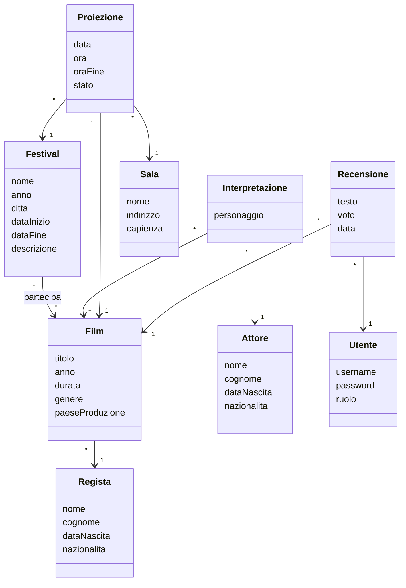

# Festival cinematografici – Sistemi Informativi su Web

Progetto assegnato dal docente (SIW, Università Roma Tre, appello di novembre 2026): un sistema informativo
per la gestione di festival cinematografici, con film, cast, sale, proiezioni e recensioni.

**Stack:** Java 21 · Spring Boot 3.5 · Spring Data JPA / Hibernate 6 · PostgreSQL · Spring Security ·
Thymeleaf + CSS scritto a mano (`static/css/app.css`, nessun framework) · React 18 + TypeScript (Vite, Material UI, axios, React Router) · springdoc-openapi (Swagger).

## Funzionalità
**Pubbliche (senza login)**
- elenco e dettaglio dei festival, film partecipanti a un festival (Thymeleaf);
- programma delle proiezioni di un festival, raggruppato per giorno e filtrabile per data (React, sola lettura);
- dettaglio di un film con regista, cast, festival, proiezioni e recensioni con media dei voti (Thymeleaf).

**Utente registrato (`USER`)**
- registrazione e login;
- inserimento di una recensione (una sola per film), modifica ed eliminazione delle **proprie** recensioni
  (form Thymeleaf nella pagina del film).

**Amministratore (`ADMIN`)**
- creazione e modifica di festival, film (con regista e cast), registi, attori e sale;
- associazione e rimozione di film da un festival (le proiezioni programmate del film vengono annullate);
- programmazione, modifica, annullamento delle proiezioni, con controlli di consistenza: nessuna sovrapposizione
  nella stessa sala, data nel periodo del festival, film associato al festival, niente proiezioni nel passato.

## Modello di dominio



| Entità | Cosa rappresenta | Relazioni |
|---|---|---|
| **Festival** | un'edizione di un festival, con il suo periodo | molti-a-molti con Film (tabella `festival_film`), uno-a-molti con Proiezione |
| **Film** | un film, con la durata in minuti | molti-a-uno con Regista; uno-a-molti con Interpretazione, Proiezione e Recensione |
| **Regista** | chi ha diretto i film | uno-a-molti con Film |
| **Attore** | un attore | uno-a-molti con Interpretazione |
| **Interpretazione** | il personaggio interpretato da un attore in un film | molti-a-uno con Film e con Attore |
| **Sala** | il luogo delle proiezioni, con la capienza | uno-a-molti con Proiezione |
| **Proiezione** | un film proiettato in una sala, in un giorno e un'ora, nell'ambito di un festival | molti-a-uno con Festival, Film e Sala |
| **Recensione** | testo e voto (1–5) di un utente su un film | molti-a-uno con Film e con Utente |
| **Utente** | chi accede: username, password cifrata con BCrypt, ruolo `USER` o `ADMIN` | uno-a-molti con Recensione |

- **Interpretazione** è un'entità associativa tra Film e Attore invece di una `@ManyToMany`: oltre al collegamento
  serve un dato in più, il personaggio (lo stesso attore può interpretare due personaggi nello stesso film).
- **Proiezione** collega tre entità: una proiezione appartiene a un festival e il suo film deve partecipare a quel festival.
- L'**ora di fine** di una proiezione è salvata (`oraFine = ora + durata del film`) perché la query che controlla
  le sovrapposizioni nella stessa sala la usa direttamente.
- Lo **stato** di una proiezione è `SCHEDULED`, `COMPLETED` o `CANCELLED`: annullare una proiezione (o togliere un
  film da un festival) non cancella righe, cambia lo stato.
- **Recensione** ha un vincolo unique `(film_id, utente_id)`: una sola recensione per utente per film.

## Prerequisiti
- JDK 21 o superiore. Con JDK più recenti di Java 21 il `pom.xml` abilita
  `-Dnet.bytebuddy.experimental=true`, necessario a Hibernate e Mockito per creare proxy e mock.
- PostgreSQL in locale sulla porta 5432, utente `postgres`, password `postgres`, con due database
  (il primo per l'applicazione, il secondo per i test e l'esperimento):
  ```sql
  CREATE DATABASE festival;
  CREATE DATABASE festival_test;
  ```
- Maven non serve: si usa il wrapper `mvnw` (`./mvnw` in Git Bash/Linux/macOS, `.\mvnw` in PowerShell o cmd).
- Node.js (LTS) per il frontend React.
- Nota per Windows: `mvnw.cmd` è stato corretto per funzionare anche se la cartella del progetto contiene
  parentesi quadre (la versione originale del wrapper leggeva i file con `Get-Content` senza `-LiteralPath`).

## Avvio
Frontend e backend sono due server separati, da avviare in due terminali.

Backend Spring Boot, su http://localhost:8080:

```bash
./mvnw spring-boot:run
```

Frontend React, su http://localhost:5173:

```bash
cd frontend
npm install
npm run dev
```

Le pagine Thymeleaf funzionano anche con il solo backend; la pagina React ha bisogno di entrambi. React chiama le API REST
del backend tramite CORS e condivide la sessione delle pagine Thymeleaf grazie al cookie `JSESSIONID`.

A ogni avvio (profilo `dev`, attivo per default) Hibernate ricrea le tabelle e `import.sql` inserisce sempre gli stessi dati
di esempio (utenti `admin`/`admin`, `user1`/`user1`, `user2`/`user2`): 3 festival (Venezia già concluso, Roma e Cannes futuri, con date relative al giorno di avvio),
20 film reali con registi e cast, 5 sale, 44 proiezioni, alcune recensioni.

### Indirizzi utili
| Pagina | URL |
|---|---|
| Home | http://localhost:8080/ |
| Festival (Thymeleaf) | http://localhost:8080/festivals |
| Programma di un festival (React) | http://localhost:5173/festivals/2/screenings |
| Dettaglio film con recensioni (Thymeleaf) | http://localhost:8080/films/1 |
| Area amministrativa | http://localhost:8080/admin |
| Documentazione API (Swagger UI) | http://localhost:8080/swagger-ui.html |

### Credenziali di esempio
| Username | Password | Ruolo |
|---|---|---|
| admin | admin | ADMIN |
| user1 | user1 | USER |
| user2 | user2 | USER |

## Test
```bash
./mvnw verify
```

94 test, tutti sullo stesso PostgreSQL locale (database `festival_test`, ricreato a ogni esecuzione):
- **unit test** dei service con Mockito (regole di programmazione, recensioni, festival);
- **integrazione** dei service: rollback di una programmazione fallita, due programmazioni concorrenti nella stessa
  sala (l'isolamento SERIALIZABLE ne fa riuscire una sola), rimozione di un film da un festival, proprietà delle recensioni;
- **repository**: query di sovrapposizione, vincolo unique delle recensioni, JOIN FETCH ed EntityGraph;
- **MockMvc**: sicurezza (redirect al login, 403 per l'area admin, login, registrazione), tutte le pagine Thymeleaf
  (compresi inserimento, modifica ed eliminazione delle recensioni e il 403 sulle recensioni altrui),
  tutte le API REST (compresi i messaggi di validazione in italiano e in inglese);
- **esperimento sulle strategie di fetch** (vedi sotto), con asserzioni sul numero di query.

## Esperimento sulle strategie di fetch
Il test `FetchStrategyExperimentTest` (profilo `experiment`, database `festival_test`) confronta strategie
diverse per lo stesso caso d'uso, sullo stesso insieme di dati: 1 festival, 100 film con 100 registi tutti
diversi, 4 sale, 300 proiezioni. Si lancia senza modificare il codice:

```bash
./mvnw test -Dtest=FetchStrategyExperimentTest
```

Per ogni strategia l'esperimento apre una nuova transazione con il persistence context vuoto
(`entityManager.clear()`), azzera le `Statistics` di Hibernate, misura il tempo con `System.nanoTime()` e stampa
query eseguite (`getPrepareStatementCount()`) e oggetti caricati. Un giro di riscaldamento iniziale non viene
conteggiato. Nel profilo sono attivi `hibernate.generate_statistics` e il log SQL formattato
(`org.hibernate.SQL=DEBUG`), così sopra ogni risultato si vedono le query eseguite.

Output tipico (i tempi variano da macchina a macchina; quelli sotto vengono da un'esecuzione reale):

```
=== Test accesso ai film del festival ===

Strategia 1: LAZY
Film caricati: 100
Query SQL: 101
Oggetti caricati in totale: 200
Tempo: 34 ms

Strategia 2: JOIN FETCH
Film caricati: 100
Query SQL: 1
Oggetti caricati in totale: 200
Tempo: 4 ms

Strategia 3: @EntityGraph
Film caricati: 100
Query SQL: 1
Oggetti caricati in totale: 200
Tempo: 3 ms

Strategia 4: Batch fetch (25)
Film caricati: 100
Query SQL: 5
Oggetti caricati in totale: 200
Tempo: 9 ms

=== Test programma del festival (proiezioni con film e sale) ===

Strategia 1: LAZY
Proiezioni caricate: 300
Query SQL: 105
Oggetti caricati in totale: 404
Tempo: 43 ms

Strategia 2: JOIN FETCH
Proiezioni caricate: 300
Query SQL: 1
Oggetti caricati in totale: 404
Tempo: 6 ms
```

### Come leggere i risultati
| Strategia | Query (N film) | Cosa succede |
|---|---|---|
| LAZY | 1 + N | una `select` sui film; `film.getRegista()` è un proxy e al primo accesso a un suo campo parte una `select ... from regista where id = ?` per ogni film: è il problema **N+1** |
| JOIN FETCH | 1 | una sola `select ... from film join regista ...`: i registi arrivano con i film |
| @EntityGraph | 1 | stessa query della strategia LAZY, ma il grafo (`attributePaths = "regista"`) fa aggiungere a Hibernate la join: SQL equivalente al JOIN FETCH |
| Batch fetch (25) | 1 + ⌈N/25⌉ | la query resta LAZY, ma Hibernate carica i proxy dei registi a gruppi: `select ... from regista where id = any (?)` con 25 id in un unico parametro array di PostgreSQL |

Nel secondo caso la strategia LAZY esegue 1 query per le proiezioni + 1 per ogni **film distinto** (100) + 1 per
ogni **sala distinta** (4) = 105: Hibernate carica ogni entità una sola volta per persistence context, quindi le
300 proiezioni non producono 600 query. Il JOIN FETCH su due associazioni *to-one* resta una sola query senza
prodotto cartesiano (ogni proiezione ha un solo film e una sola sala).
Il numero di oggetti caricati è uguale in tutte le strategie: cambia solo *quante volte* si va al database.

### Come scala al crescere di N
| Film | LAZY | JOIN FETCH / @EntityGraph | Batch (25) |
|---|---|---|---|
| 10 | 11 query | 1 query | 1 + 1 = 2 query |
| 100 | 101 | 1 | 1 + 4 = 5 |
| 1.000 | 1.001 | 1 | 1 + 40 = 41 |
| 100.000 | 100.001 | 1 | 1 + 4.000 = 4.001 |

Con LAZY il tempo cresce linearmente con N, ed è dominato dalla latenza di rete di ogni andata e ritorno
verso il database (qui il DB è locale, in produzione ogni query costa molto di più). Con JOIN FETCH le query
restano una sola: cresce solo la quantità di righe trasferite. Con 100.000 film però anche una sola query
restituirebbe troppi dati per una pagina: lì serve la paginazione (come in `GET /rest/movies`), che con JOIN FETCH
su associazioni *to-one* funziona senza problemi. Il JOIN FETCH di una *collezione* invece moltiplica le righe e
non si combina bene con la paginazione (Hibernate pagina in memoria): per questo il progetto non fa mai JOIN FETCH
di più collezioni insieme e, dove serve, usa query separate.

Le asserzioni del test fissano questi numeri (101, 1, 1, 5, 105, 1): se una modifica reintroduce un N+1, il test fallisce.

## Architettura
Architettura a livelli: ogni livello usa solo quello sottostante.

```
Browser ──► Spring Security (filtri: sessione, ruoli)
              │
              ├─► controller        Thymeleaf (MVC): riceve la richiesta, valida il form, chiama il service, sceglie la vista
              ├─► controller.rest   REST per React: riceve JSON, chiama il service, restituisce le entità in JSON
              │
              ▼
           service                  casi d'uso e regole di business, @Transactional
              │
              ▼
           repository               Spring Data JPA: query derivate, JPQL con JOIN FETCH / @EntityGraph, UPDATE di massa
              │
              ▼
           model (entità JPA) ──► PostgreSQL
```

| Package (`it.uniroma3.siw.festival`) | Contenuto |
|---|---|
| `model` | 9 entità JPA (Festival, Film, Regista, Attore, Interpretazione, Sala, Proiezione, Recensione, Utente) e 2 enum |
| `repository` | interfacce Spring Data JPA con le query di ogni caso d'uso |
| `service` | casi d'uso, regole di business, transazioni |
| `controller`, `controller.admin` | controller Thymeleaf (pagine pubbliche, login, area amministrativa) e `@ControllerAdvice` globali (trim delle stringhe, utente corrente) |
| `controller.rest` | controller REST usati da React (`/rest/**`) e `RestExceptionHandler` con gli errori in JSON |
| `exception` | eccezioni di dominio |
| `authentication` | `AuthConfig` (Spring Security, login, regole sugli URL) e `CorsConfig` |
| `config` | metadati OpenAPI |

Scelte principali:
- **Fetch**: tutte le associazioni sono LAZY (anche le `@ManyToOne`, che in JPA sarebbero EAGER) e
  `spring.jpa.open-in-view=false`; ogni caso d'uso carica ciò che gli serve con query dedicate, senza mai mettere
  in JOIN FETCH più collezioni nella stessa query.
- **Transazioni**: service in `@Transactional(readOnly = true)`, scritture in `@Transactional`; isolamento di default
  (READ_COMMITTED) tranne dove il caso d'uso legge dei dati per decidere se scrivere: la programmazione e la modifica
  di una proiezione usano `Isolation.SERIALIZABLE`, così due programmazioni concorrenti sovrapposte nella stessa sala
  non possono riuscire entrambe (una viene annullata da PostgreSQL e l'utente riceve un 409 "riprova").
- **Logging**: SLF4J nei service (`INFO` per gli eventi di business, `WARN` per le regole violate, `ERROR` per gli
  errori inattesi); livelli configurati in `application.properties`.
- **Sicurezza**: form login con sessione, BCrypt, regole sugli URL (`/admin/**` solo ADMIN), controllo della
  proprietà delle recensioni nel service; il token CSRF protegge i form Thymeleaf, mentre `/rest/**` e il logout ne sono esclusi.
- **Validazione ed errori**: Bean Validation sulle entità (usate direttamente nei form) con i testi dei messaggi in `messages/messages.properties`
  (italiano) e `messages_en.properties` (inglese); `GlobalExceptionHandler` con pagine 403/404/500 personalizzate
  per Thymeleaf, `RestExceptionHandler` (JSON) per le API.

## Struttura del repository
```
├── pom.xml                         dipendenze del backend
├── mvnw, mvnw.cmd, .mvn/           Maven wrapper
├── frontend/                       React + TypeScript + Vite (src/: types, services, context, components, pages, theme)
└── src/
    ├── main/java/it/uniroma3/siw/festival/   codice Java (package descritti sopra)
    ├── main/resources/
    │   ├── application*.properties           configurazione (profilo dev)
    │   ├── import.sql                         dati di esempio (caricati a ogni avvio)
    │   ├── messages/                          messaggi di validazione e testi (it, en)
    │   ├── templates/                         pagine Thymeleaf
    │   └── static/                            CSS
    └── test/                                  test e profili test / experiment
```

## Licenza
MIT, vedi [LICENSE](LICENSE).
